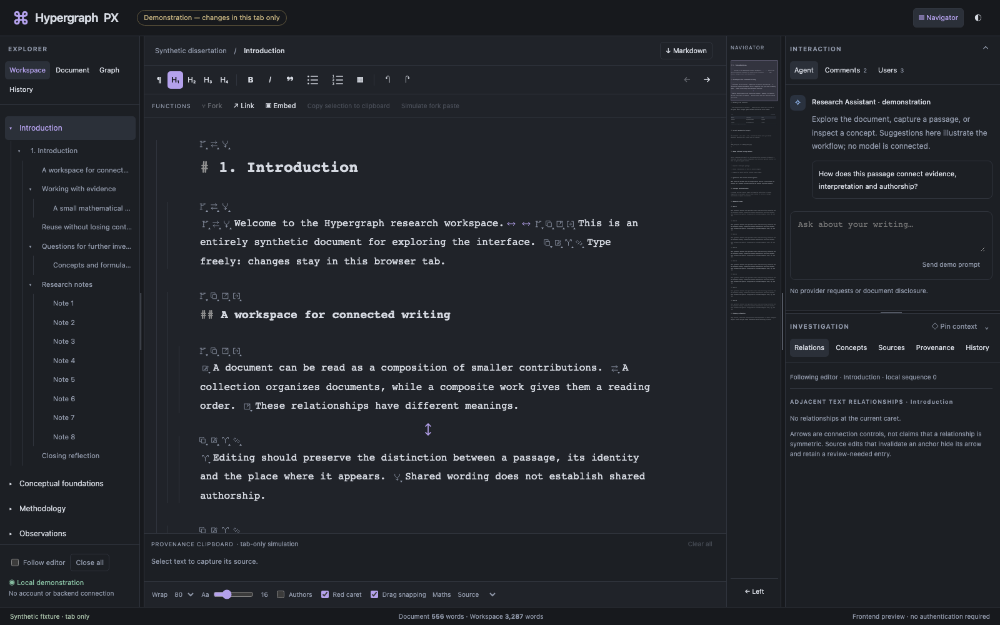

# Hypergraph PX

Hypergraph PX is a local-first writing and thinking environment built around identifiable, reusable and versioned content, with future multi-user and federated collaboration.

Read the [project purpose](docs/01-purpose/project-purpose.md), [documentation index](docs/README.md) and [development state](docs/09-guides/reference/DEVELOPMENT_STATE.md).



*Published synthetic frontend preview; this image is not evidence of live Rust integration.*

## Current status

Source version **0.8.0** includes the nine-level documentation migration, encrypted SQLite storage and an HTTPS runtime scaffold. The **0.7.0** image above remains the synthetic frontend preview. Live browser integration remains unfinished and is not accepted for real documents. Application implementation remains paused.

## Developer setup

Use Rust stable with a native compiler/linker and Node.js26/npm to prepare the frontend:

```sh
npm --prefix frontend ci --ignore-scripts
npm --prefix frontend run build
cargo +stable build --workspace --locked
cargo +stable test --workspace --locked -- --test-threads=1
```

For the synthetic browser preview, run `npm --prefix frontend run dev` and open http://127.0.0.1:5173/. Its content is tab-local and resets on reload. See the [developer guide](docs/09-guides/developers/getting-started.md) for build/check boundaries. The unfinished integrated runtime is not yet accepted for real documents.

## Future design aims

Reusable content with exact history/provenance; reviewed agent assistance and comments; Zotero citations; Word review import; local spell checking; reproducible exports; multi-user/live coediting and branches; federation; client-held encryption; and release notifications/updates remain scoped by the [roadmap](docs/02-governance/roadmap.md), [user needs](docs/03-requirements/user-needs.md) and [integration contracts](docs/06-subsystems/external-integrations.md). Desktop comes first; mobile is deferred. Release packaging targets one Rust executable with embedded frontend assets.

## Documentation and assurance

The [nine-level index](docs/README.md) distinguishes requirements, decisions, implementation and verification. Earlier documentation is preserved in local ignored `.oldspecs/`; [source registers](docs/registers/source-manifest.csv) identify original and current paths/checksums. The [full formal-validation digest](docs/08-assurance/formal-validation-digest.md) explains exactly which Lean/model/extracted-Rust results have evidence and their limits.

Repository: [dfdy/hypergraph-px](https://github.com/dfdy/hypergraph-px), public. Original application code: [AGPL-3.0-only](LICENSE). User content and upstream licenses retain their own rights. The owner authorized this source publication on 2026-10-25; future publication requires a new explicit request.
