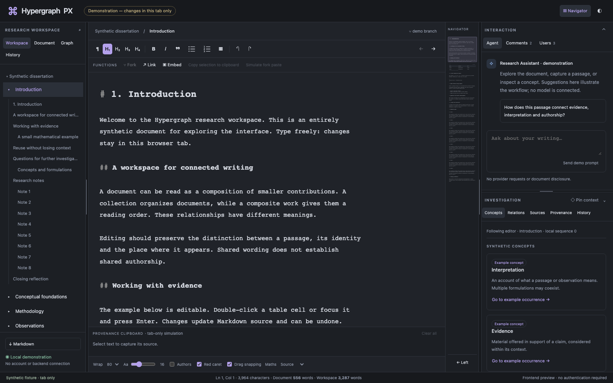

# Hypergraph PX:
## The Graph Is More Than a Storage Mechanism

**Hypergraph PX is a graph-based document editing system that treats documents not as isolated, static files, but as evolving compositions of interconnected, reusable, and independently versioned content.**



*Figure 1: Hypergraph PX showing the document editor. Please note this is an early screenshot and the editor is not yet fully implemented.*

Conventional documents are organised as trees: documents contain sections, sections contain paragraphs, and paragraphs contain sentences. Hypergraph PX preserves this familiar structure while extending it through a network of relationships between content, its origins, its revisions, and its uses across different documents.

At its core, Hypergraph PX is built around a **typed, directed, attributed, temporal multigraph composed of several mathematically constrained subgraphs**. Each represents a different relationship between content and its development:

- **Composition trees** describe how content is organised into documents, preserving the order and hierarchy needed for reading and editing.
- **Reference graphs** connect content through hyperlinks, citations, and other relationships, allowing connections across documents and back to their ancestors.
- **Revision graphs** preserve the history of every independently identifiable piece of content, allowing revisions to branch and merge without overwriting earlier versions.
- **Provenance graphs** record how content originated, was extracted, forked, combined, or transformed, preserving traceable relationships between original and derived material.
- **Document snapshots** preserve reproducible historical states, allowing an entire document to be reconstructed as it existed at a particular recorded revision.

These structures coexist within a common graph but obey different mathematical rules. Document containment requires a coherent hierarchy, while hyperlinks may form cycles. Revision histories can branch and merge but must preserve their causal ancestry. A paragraph may appear in several documents without duplicating its identity or losing its individual history.

The distinction between **content, its identity, its history, and its position within a document** is fundamental. A sentence, paragraph, or section can be edited independently, reused elsewhere, or forked into a new version while retaining a navigable connection to its source. Documents can consequently be assembled from existing material without sacrificing the independence or historical continuity of their constituent parts.

This architecture makes it possible to optimise storage, retrieval, version management, document compilation, and graph traversal using algorithms suited to each relationship. More importantly, it extends the possibilities of document editing beyond the production of successive, self-contained texts.

**A document becomes a historically situated composition of identifiable and reusable intellectual material.**

Its structure shows how ideas are organised. Its references show how they relate. Its provenance reveals how they came into existence. Its revision history records how they developed, diverged, and converged.

Hypergraph PX is therefore intended not merely as a system for writing and organising documents, but as a means of exploring the relationships, transformations, and histories through which knowledge is developed, revised, shared, and collectively constructed.

See [development state and handoff](docs/DEVELOPMENT_STATE.md) for current progress, validation evidence and resumption steps.

## Future design aims

The following capabilities are planned and are **not yet implemented**. They build on the [product specification](Specifications/SPECIFICATION.md) and its staged delivery plan.

- **Zotero citation integration:** search and select references from a Zotero library through a read-only integration, insert citations while writing, and use bibliographic metadata during document compilation/export. Preserve the exact citation metadata and formatting inputs needed to reproduce a recorded document; reading a historical snapshot must not silently refresh its references. Writing back to the Zotero library is outside the initial integration scope.
- **Desktop writing workspace:** a four-column layout with chapter/section contents, a styled Markdown source editor, a navigable document minimap, and a sidebar with separate Agent, Comments and Users tabs. Users lists document contributors, with the current human and agent pinned above the other contributors, each with its own colour. Preserve whole-document selection and precise ownership of text, including repeated and nested content. Mobile responsiveness is deferred.
- **Reusable content and navigable history:** edit and reuse independently versioned content, fork or split it with traceable provenance, compare branches, and selectively integrate changes. Explore occurrences, references, backlinks and derivations without losing the exact state captured by a document snapshot.
- **Agent assistance and anchored comments:** discuss selected context, review proposed edits and approve precisely scoped changes. Keep human comments separate from agent conversation, distinguish human and agent identities, and recheck permissions and document state before applying an approved proposal. External model disclosure must be explicit.
- **Reproducible compilation and export:** assemble documents from their exact recorded content, structure, citation data and compiler inputs. Keep recoverable editing drafts separate from explicitly committed history, and reproduce snapshots without consulting newer content heads.
- **Multi-user collaboration and federation:** introduce users, devices and groups, supporting both live coediting and explicit branches/merges. Begin sharing at workspace/document scope, with full retained history shared only by explicit grant; validate authorization and structural consistency independently of synchronization or encryption.
- **Client-held encryption:** add an alternative to the default trusted-server mode, keeping decryption keys and plaintext operations at an authorized client. Recovery will use a user-held key. The stronger confidentiality guarantee against a malicious hosting server requires an independently trusted client and update channel.

These aims describe direction rather than a release-date commitment. Detailed mechanisms and acceptance checks must be specified before each capability is enabled.

## Current status

Early development: pure Rust expansion validation and in-memory encryption/key wrapping are implemented. Durable workspace storage, the browser editor and a runnable application are still planned. Current version: **0.1.7**; license: [AGPL-3.0-only](LICENSE).

## Developer installation

Install Git and [Rust through rustup](https://www.rust-lang.org/tools/install), including the native compiler/linker prerequisites for your platform. The repository is currently private, so your GitHub account needs access to clone it.

Clone the repository and install the stable Rust toolchain with the formatting/lint components:

```sh
git clone https://github.com/dfdy/hypergraph-px.git
cd hypergraph-px
rustup toolchain install stable --profile minimal --component rustfmt,clippy
```

Build the workspace and run its tests using the committed dependency lockfile:

```sh
cargo +stable build --workspace --locked
cargo +stable test --workspace --locked
```

This currently builds Rust library crates; there is no application launch command yet. Rust-only checks do not require Node.js. The [frontend intake guide](frontend/README.md) describes the upload location and planned separate mock-data development runtime; frontend setup commands will be documented after the export is reviewed.

Before contributing, run formatting and lint checks:

```sh
cargo +stable fmt --all -- --check
cargo +stable clippy --workspace --all-targets --locked -- -D warnings
```

Lean is optional for ordinary Rust development. For proof toolchains and reproduction commands, see [formal assurance](proofs/README.md) and [extracted Rust proof replay](proofs/rust/README.md).

Read [AGENTS.md](AGENTS.md) for contribution instructions, the [specification index](Specifications/README.md) for requirements and architecture, and the [data/navigation reference](Specifications/DATA/README.md) and [crypto adapter reference](crates/crypto/README.md) for implemented APIs. Progress and next steps are in the [development handoff](docs/DEVELOPMENT_STATE.md); version history is in [CHANGELOG.md](CHANGELOG.md).

For browser interface work, use the [frontend integration specification](Specifications/FRONTEND_INTEGRATION.md), including its adapter boundary, fixture work order and acceptance scenarios.
