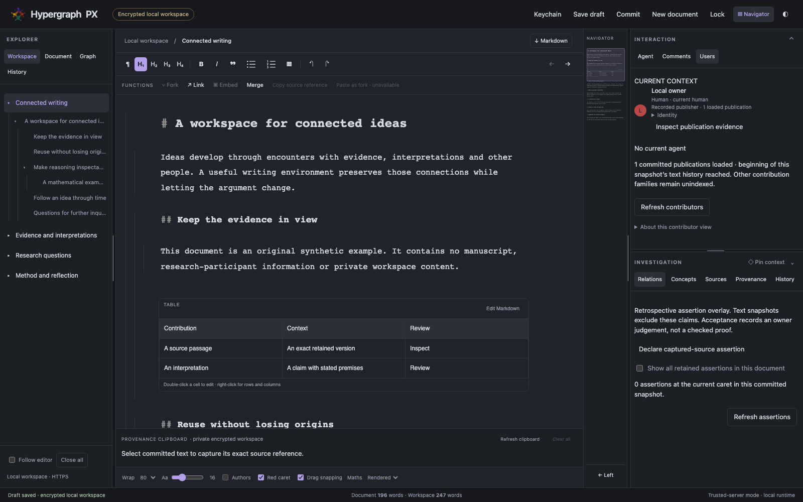

# Hypergraph PX


**Hypergraph PX (HPX)** is a writing and thinking environment born out of my frustration with writing a doctoral dissertation in software that doesn't let me work the way I think.

Writing tools, from Microsoft Word to Scrivener, are useful, but I've always found it strange that writing software still lacks capabilities that programmers have taken for granted for decades, such as Git-like versioning, branching, and the ability to define meaningful relationships between specific parts of a document. Ideas don't develop in neat, linear sequences. They overlap, contradict, diverge, reconnect, and change through our encounters with other ideas and people. Why shouldn't our writing tools accommodate that?

HPX explores a different approach: treating writing as an evolving network of identifiable, reusable, and versioned contributions, while still allowing us to work with familiar, readable documents. Its [hypergraph](https://en.wikipedia.org/wiki/Hypergraph) structure allows relationships to connect multiple pieces of content in multiple user-determined ways, rather than simply linking documents or paragraphs. It aims to make these relationships explicit, preserve their histories, and support experimentation without losing what came before.

Underlying the project is a commitment to **intellectual autonomy, transparency, privacy, and collaboration**. It is a tool that helps people think together without obscuring who contributed what, including when collaborating with AI. It begins as a personal writing environment but is ultimately intended to become a secure, federated, collaborative commons for writing and inquiry.



*Current local frontend preview, captured on 2026-10-26 with synthetic content. This synthetic preview image is not evidence of live Rust integration.*

### How it's being built

HPX has a back-end written in [Rust](https://en.wikipedia.org/wiki/Rust_(programming_language)) and a browser-based front-end built using HTML, CSS, and JavaScript, with [CodeMirror 6](https://codemirror.net/) providing the editing framework and [KaTeX](https://katex.org/) rendering mathematical notation. The front-end is bundled into the Rust executable, allowing HPX to run as a standalone application without requiring a separate web server or JavaScript runtime. The mathematical properties of its hypergraph operations are formally specified and verified using the [Lean](https://en.wikipedia.org/wiki/Lean_(proof_assistant)) programming language and proof assistant. My intention is to make its foundations not only flexible but also precise, inspectable, and, wherever possible, mathematically demonstrable. Formal proofs establish particular properties of specified operations, not the correctness of the entire application.

HPX is being developed in collaboration with the [Codex](https://openai.com/codex/) AI agent, working primarily through the [VS Code](https://en.wikipedia.org/wiki/Visual_Studio_Code) IDE. This makes the development process itself an experiment in transparent human–AI collaboration, reflecting one of HPX's central ambitions: to make contributions, decisions, and their histories visible, attributable, and open to critical examination.

The application is designed as a **standalone, cross-platform executable** with an embedded [SQLite](https://en.wikipedia.org/wiki/SQLite) database and a browser-based interface served locally over HTTPS. It requires neither Docker nor a separate database server. The same executable provides **command-line capabilities** for importing, exporting, backing up, verifying, and managing workspaces, making HPX useful for both interactive writing and automated workflows. Native executables can be compiled for supported operating systems.

Because HPX is intended to hold sensitive research-participant information, unfinished thoughts, and sometimes deeply personal intellectual work, **security is a foundational requirement, not an afterthought**.

Its security commitments include:

- **Encryption at rest:** Workspace contents, including documents, graph relationships, revisions, provenance, and sensitive metadata, are protected through authenticated encryption of the embedded SQLite storage. Encryption keys are managed separately from the encrypted data, with passphrase-based recovery and optional integration with operating-system key storage.
- **Encryption in transit:** The browser communicates with the local application over HTTPS, protecting information exchanged between the interface and the Rust engine, even when both run on the same machine. Future remote and federated connections will provide equivalent authenticated, encrypted communication.
- **Cryptographic provenance:** Contributions, revisions, relationships, and significant actions are designed to have verifiable histories using cryptographic hashes and attributable identities, including distinct identities for human users and AI agents. This should make unauthorized changes detectable without confusing proof of data integrity with proof that an attribution is truthful.
- **Secure collaboration:** Multi-user permissions, identity management, encrypted information exchange, and federation are architectural concerns from the outset, rather than features to be retrofitted later. The longer-term aim is collaboration between independently operated workspaces without requiring a central authority or surrendering control over private data.
- **User control and portability:** Workspaces remain locally owned, encrypted, and portable. Publishing, sharing, exporting, and granting access will be deliberate, understandable actions, with clear boundaries between private material and information made available to others.

These are design commitments, not claims that every protection is already fully implemented or independently security-audited.

The goal is not simply to protect documents, but to make their development traceable without sacrificing the privacy, autonomy, or control of the people creating them.

And yes, the **PX** is a slightly tongue-in-cheek nod to [Project Xanadu](https://en.wikipedia.org/wiki/Project_Xanadu), whose ambitious vision of interconnected documents remains an inspiration.

For more, see the [project purpose](docs/01-purpose/project-purpose.md), [documentation index](docs/README.md), and [development state](docs/09-guides/reference/DEVELOPMENT_STATE.md).

## Current status

Source version **1.0.0** includes the integrated one-owner HTTPS/SQLite workflow, exact source and immutable history, opt-in macOS Keychain unlock with retained passphrase recovery, protected provenance captures, independent Fork and reviewed synthesis, retrospective assertions and selected-node graphs. Publication contributors are an explicitly incomplete evidence view. Synthetic integration checks pass; real-document acceptance and broader feature/platform coverage remain pending. The major version records incompatible domain API and experimental-record decoding changes, not completion of the product. See the [implementation handoff](docs/09-guides/reference/DEVELOPMENT_STATE.md) and [publication record](docs/09-guides/reference/source-publication-1.0.0.md).

For the synthetic browser preview, run `npm --prefix frontend run dev` and open [http://127.0.0.1:5173/](http://127.0.0.1:5173/). Its content is tab-local and resets on reload. See the [developer guide](docs/09-guides/developers/getting-started.md) for build/check boundaries. The unfinished integrated runtime is not yet accepted for real documents.

## Future design aims

Reusable content with exact history/provenance; reviewed agent assistance and comments; Zotero citations; Word review import; local spell checking; reproducible exports; multi-user/live coediting and branches; federation; client-held encryption; and release notifications/updates remain scoped by the [roadmap](docs/02-governance/roadmap.md), [user needs](docs/03-requirements/user-needs.md), and [integration contracts](docs/06-subsystems/external-integrations.md). Desktop comes first; mobile is deferred. Release packaging targets one Rust executable with embedded frontend assets.

## Documentation and assurance

The [nine-level index](docs/README.md) distinguishes requirements, decisions, implementation, and verification. The [full formal-validation digest](docs/08-assurance/formal-validation-digest.md) explains exactly which Lean/model/extracted-Rust results have evidence and their limits.

Repository: [dfdy/hypergraph-px](https://github.com/dfdy/hypergraph-px), public. Original application code: [AGPL-3.0-only](LICENSE). User content and upstream licenses retain their own rights. The owner authorized this source publication on 2026-10-25; future publication requires a new explicit request.

## Developer setup

Use Rust stable with a native compiler/linker and Node.js 26/npm to prepare the frontend:

```sh
npm --prefix frontend ci --ignore-scripts
npm --prefix frontend run build
cargo +stable build --workspace --locked
cargo +stable test --workspace --locked -- --test-threads=1
```