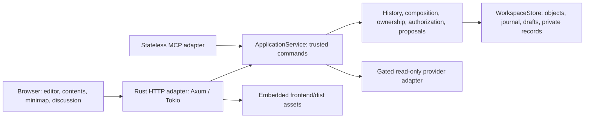

# Hypergraph PX: technical evaluation and rebuild handover

**Evidence date:** 24 October 2026. **Application version:** 0.0.1. **Audience:** an engineer or agent evaluating this test of concept or building its successor.

This document describes the software that exists, the recorded route to it, and lessons for a new implementation. It adds no product requirements. [SPECIFICATION.md](SPECIFICATION.md) remains the sole authoritative product specification; its acceptance gates override historical implementation notes. [implementation-status.md](implementation-status.md) is an accumulated progress record whose older entries describe earlier states.

The inventory covers every retained ADR and local implementation task at this cutoff. The mistake register covers errors and corrections supported by those records, current verification, or the owner's recorded instructions. An exhaustive account of every failed edit is unavailable: this folder has no Git repository, commit history or complete retained command transcript. Recommendations and inferred architectural costs are labelled accordingly. No credentials or private document excerpts are included.

## 1. Evaluation at a glance

The strongest result is a coherent local persistence model: immutable payloads and independently identified revisions, ordered composition manifests, exact contextual snapshots, and a single journal publication point. Human editing, recoverable drafts, offline agent approvals and provenance now exercise that model through a real browser. A separate frontend development package improves iteration while release assets remain embedded in one Rust executable.

The main development cost has been reaching that usable whole-document workflow through many intermediate representations and narrowly scoped increments. Autosave semantics, document launch, session lifetime and editor ownership were clarified after related work had begun. Replay-heavy requests and accumulated browser fixtures then amplified verification time. These are reasons to establish a small end-to-end workflow and its state model earlier in the successor.

| Area | Implemented at cutoff | Qualification |
|---|---|---|
| Packaging | Rust executable with embedded HTML/CSS/JavaScript; independent frontend build/dev gateway | Node and Chromium are development tools; no Node runtime in deployment |
| Persistence | Confined workspace, exclusive writer, immutable typed objects, sealed journal, replay validation | Physical power-loss/disk-full coverage and complete backup/migration acceptance remain open |
| Document editing | Bound document opens on main; styled source editor; whole-buffer editing of supported owners | Root-local prose and unique direct live text owners are writable; general nested/repeated/pinned whole-buffer mutation is incomplete |
| Autosave | Five-second idle durable working drafts; explicit immutable revision commit | A draft is current working state, not an autosave revision timeline |
| Branches | Exact-snapshot creation, isolated edits, historical reconstruction and detailed comparison | Selective three-way integration/merge commit and full conflict-resolution UI are not implemented |
| Structural authoring | Human selection promotion/fork/sentence-or-paragraph split/new-identity prose merge | Supported local/direct selections; nested mutation paths remain limited |
| Agent authoring | Retained deterministic offline mock proposals, exact preview and explicit attributed approval | Mock authoring is gated; live model authoring remains disabled |
| Live chat | Retained OAuth connection, model discovery and bounded read-only streamed adapter | Offline fixtures validate protocol/recovery; complete real-provider lifecycle acceptance is not established |
| UI layout | Desktop contents, editor, minimap and Agent/Comments tabs | Comments is a placeholder; persistent anchored threads and full panel preferences remain pending |
| MCP | Stateless discovery, specification resources, workspace information and logic-operator catalogue | No document mutation parity, scoped machine credentials or enabled MCP writes |
| Graph/Zotero/search | Composition primitives, logic-label drafts and validated configuration | Durable reasoning relations, general indexing/search, Zotero requests and scholarly export remain pending |
| Deployment | Direct loopback app and fixed loopback development gateway | Production reverse-proxy deployment is a specification target, not a supported current configuration |

No complete normative stage or 0.1.0 release is claimed. Mobile work is deferred by the owner. Multiple human users and collaborative presence belong to the separately planned PX MU application; independent browser sessions for the current single human are supported.

## 2. Technical specification of the implemented architecture

### 2.1 Runtime and development topology



One process owns the workspace writer lock. The browser does not open workspace files, manufacture trusted principals, validate durable history or decide publication. HTTP and MCP are adapters around core services, although MCP currently exposes only discovery/read-only catalogues. Provider adapters do not gain content-write authority from having valid OAuth credentials.

During frontend development the browser instead reaches a loopback Node gateway, which serves current frontend files and proxies permitted requests to one fixed loopback Rust backend. This enables frontend rebuilds without restarting Rust. The gateway preserves backend CSP nonces, cookies, status, streaming and cancellation, validates its incoming Host/Origin/CSRF boundary before header normalization, and cannot choose an arbitrary upstream. It is not the production reverse-proxy feature. Release builds contain `frontend/dist` and require no frontend server or asset directory. See [ADR 0040](adr/0040-separated-frontend-development.md).

### 2.2 Repository boundaries and important entry points

| Location | Current responsibility |
|---|---|
| [crates/http/src/main.rs](../crates/http/src/main.rs), [launch.rs](../crates/http/src/launch.rs), [config.rs](../crates/http/src/config.rs) | CLI/config loading, application startup, listener and shutdown |
| [crates/http/src/server.rs](../crates/http/src/server.rs), [server/editor.rs](../crates/http/src/server/editor.rs), [auth.rs](../crates/http/src/auth.rs) | Routes, pages/assets, session/transport guards and request decoding |
| [crates/core/src/lib.rs](../crates/core/src/lib.rs) | Application service and module boundary |
| [history.rs](../crates/core/src/history.rs), [document_history.rs](../crates/core/src/document_history.rs), [text_history.rs](../crates/core/src/text_history.rs) | Typed revisions/provenance, unified document events/replay and legacy text substrate |
| [composition.rs](../crates/core/src/composition.rs), [composition/codec.rs](../crates/core/src/composition/codec.rs) | Ordered manifests, contextual dependency capture/reconstruction and strict closure codec |
| [editing.rs](../crates/core/src/editing.rs), [composed_editing.rs](../crates/core/src/composed_editing.rs), [working_drafts.rs](../crates/core/src/working_drafts.rs) | Authorized human commands, ownership-preserving multi-source changes and draft orchestration |
| [anchors.rs](../crates/core/src/anchors.rs), [source_map.rs](../crates/core/src/source_map.rs), [document_focus.rs](../crates/core/src/document_focus.rs) | Exact immutable targets, Markdown/Unicode boundaries and composed context |
| [range_derivation.rs](../crates/core/src/range_derivation.rs), [promotion.rs](../crates/core/src/promotion.rs), [splitting.rs](../crates/core/src/splitting.rs), [prose_merge.rs](../crates/core/src/prose_merge.rs) | Range lineage, byte-preserving partitions and derived fragments |
| [authorization.rs](../crates/core/src/authorization.rs), [accounts.rs](../crates/core/src/accounts.rs) | Separate human/agent principals, permission requests, approvals and local accounts |
| [conversation.rs](../crates/core/src/conversation.rs), [proposal.rs](../crates/core/src/proposal.rs), proposal modules | Retained turns, frozen plans, preview and independently validated approval effects |
| [chatgpt.rs](../crates/core/src/chatgpt.rs), [responses.rs](../crates/core/src/responses.rs), [live_agent.rs](../crates/core/src/live_agent.rs) | Provider authorization, response parsing and durable dispatch/recovery |
| [branch_comparison.rs](../crates/core/src/branch_comparison.rs), [text_diff.rs](../crates/core/src/text_diff.rs), [merge.rs](../crates/core/src/merge.rs) | Frozen branch/structural/prose comparisons and conservative manifest-only merge reference planner |
| [crates/storage/src](../crates/storage/src/lib.rs) | Filesystem safety, immutable publication, journal, draft/projection/auth/job records |
| [crates/mcp/src/lib.rs](../crates/mcp/src/lib.rs) | Pinned stateless protocol, discovery resources and limited read-only tools |
| [frontend/src](../frontend/src/editor.html) | Browser templates, styling, CodeMirror adapter, editor/conversation/comparison controls |
| [frontend/scripts](../frontend/scripts/build.mjs), [frontend/tests](../frontend/tests/gateway.test.mjs) | Reproducible build, local gateway and boundary contracts |
| [tests/ui](../tests/ui/editor.spec.mjs), [scripts](../scripts/test_editor_restart.py) | Browser, process recovery, executable-only and benchmark harnesses |

The Cargo workspace currently has four crates: core, storage, HTTP and MCP. Markdown parsing, graph/composition and provider concerns are modules/dependencies rather than separately implemented markdown/graph/citations crates. The frontend uses JavaScript with CodeMirror 6 and esbuild; no frontend application framework or TypeScript-generated API client has been introduced.

The main implemented browser contracts are listed below. This is a navigation aid to the actual request structs and handlers, not a duplicate normative wire schema.

| API surface | Role |
|---|---|
| `GET /api/v1/editor/current`, `GET /api/v1/editor/document/{root}/{branch}` | Bound root/branches and exact document state, owners, source spans and snapshot |
| `GET /api/v1/editor/transaction-id`, `POST /api/v1/editor/command` | Server-issued action identity and typed human content/structure/branch commands |
| `POST /api/v1/editor/draft`, `GET /api/v1/editor/draft/{root}/{branch}` | Generation-bound durable working state and recovery |
| `POST /api/v1/editor/focus` | Exact saved sentence/paragraph/section/range/cursor context |
| Promotion/fork/split/prose-merge preview POST routes | Pure plans for explicit subsequent execution, not publication |
| `POST /api/v1/editor/turn`, conversation GET, proposal GET and approve POST | Retained conversation, frozen proposal review and explicit approved mutation |
| `GET /api/v1/editor/job/{id}` | Authorized recovery of durable live-request state |
| `GET /api/v1/editor/compare/{root}/{branch}` | Exact comparison; optional source/target/base snapshots, target branch, direction, limit and cursor |
| `/api/v1/auth/*`, `/api/v1/chatgpt/*` | Separate local account/session and provider connection lifecycles |
| `/health/live`, `/health/ready`, `/api/v1/workspace`, `/mcp` | Listener/readiness, redacted workspace status and pinned MCP adapter |

Writes use authenticated same-origin requests with the transport's CSRF proof. Trusted actors, grants and model attribution are not accepted merely because a browser supplied matching IDs. Read routes also enforce their content/session boundary. See the [router](../crates/http/src/server.rs) and [editor handlers](../crates/http/src/server/editor.rs) for exact methods, limits and decoding rules. MCP is pinned to stateless protocol `2026-07-28`, requiring per-request protocol/capability metadata and matching method/name headers; no initialize session or document-write endpoint should be invented by a successor client.

### 2.3 Identity, content, composition and snapshots

The following distinctions are essential to correctness:

| Concept | Meaning and identity |
|---|---|
| Node | Stable independently addressable content or composition identity, using typed UUIDv7 IDs |
| Revision | Immutable event/state belonging to one node; equal bytes do not make two revisions the same event |
| Payload | Exact UTF-8 Markdown, addressed by a typed SHA-256 object digest; byte deduplication conveys no shared authorship or logical identity |
| Inclusion | Stable occurrence ID in an ordered manifest; two uses of one node remain distinct occurrences |
| Manifest revision | Ordered local Markdown parts and typed inclusions, plus non-expanding links; its own same-identity parents/history |
| Snapshot | Logical snapshot ID plus complete exact dependency resolution, including contextual occurrence bindings |
| Branch | Stable branch ID/name/root with append-only expected→next snapshot transitions; main is the default view |
| Derivation | Exact cross-identity source/revision/range/output mapping for extraction, fork, split or prose merge |

Same-identity revision parents form a DAG. Creating a new fork/extracted/split/merged fragment creates a new identity whose first revision has no cross-identity parents; derivation origins link it to its sources. Restoring or resolving content must append history rather than rewrite earlier records. Ordered provenance mappings preserve the bytes contributed by each original source.

Inclusion rules distinguish live selection, a particular revision, and a complete snapshot/context closure pin. A revision pin of a nested manifest does not by itself freeze that manifest's live descendants. A closure pin does. The same manifest revision can therefore appear under different historical resolutions. A map keyed only by node ID or revision ID is insufficient: use occurrence/context keys and preserve complete inclusion paths.

Historical reconstruction follows the recorded closure, checks present read permission and integrity, and never substitutes current heads. A legitimate repeat must render again; transclusion cycle detection follows the active traversal path rather than globally suppressing repeated nodes. Links are not recursively expanded. Current default render budgets are depth 64, 10,000 vertices/source spans and 16 MiB output; additional aggregate-work checks protect metadata-heavy expansion. A bounded request must fail or report unavailable detail honestly, never prune retained history.

### 2.4 Persistence, authority and publication

The workspace identity is in `.hypergraph/manifest.json`. Content-facing directories include `documents/`, `fragments/` and `bibliography/`; `.hypergraph/` holds private object/journal/node/auth records. Current Markdown files are working projections. There is no implemented authoritative SQLite content store; the planned SQLite index is rebuildable and must remain subordinate to immutable objects and committed journal events.

Object identifiers have the form `v1:sha256:<digest>`. The hash covers a type-specific domain header, a big-endian byte length and the exact object bytes. Markdown, revision-envelope and resolution objects cannot be interchanged just because their bodies resemble one another. Current storage limits include 16 MiB Markdown, 64 KiB revision envelope, 4 MiB resolution object and 1 MiB journal record; command/HTTP limits can be smaller. Validate the specific path rather than assuming the largest object size is a valid request size.

The unified document stream represents text references, manifest records, snapshots, branch transitions and common attribution inside the existing sealed journal mechanism. It is not a second independently authoritative log. Legacy text records remain readable. Ledger order determines publication/history navigation, while revision parentage remains branch-aware and independent of the latest workspace event.

The publication protocol is:

1. Resolve the trusted principal and one validated history view; check exact source revisions, expected branch head, permissions, draft state and operation shape.
2. Construct the entire change set and validate resulting ownership, provenance and dependency closure.
3. Stage and durably publish immutable objects. Their existence alone does not constitute committed history.
4. Publish one sealed journal change set with expected-head checks. This is the visibility boundary for the atomic content/manifest/snapshot/branch change.
5. Reconcile disposable projections and return a receipt. An uncertain outcome retains the original transaction identity for exact retry/recovery.

Do not turn an uncertain acknowledgement into a new transaction. Identical committed retries return the original result even after later work; changed request reuse conflicts. Publication uncertainty can require reopening/replaying before further operations. Orphan objects do not become revisions. Missing or semantically invalid committed dependencies fail startup/readiness rather than being skipped. See [ADRs 0008–0009](adr/0008-immutable-history-journal.md) and [0024](adr/0024-atomic-document-transaction-stream.md).

### 2.5 Draft and browser state model

Five-second idle autosave persists a mutable, durable working draft and corresponding Markdown without adding revision objects, snapshots or branch transitions. An explicit commit publishes one coherent revision transaction, then retires/reconciles the draft. Draft records bind actor, branch, exact committed base, generation, request identity, checksums and changed owners. Schema 1 covers the original body draft, schema 2 root-local prose, and schema 3 composed owner changes. Canonical older records retain their encoding.

Draft publication is record-first, followed by its working-file projection. Recovery distinguishes an interrupted write from an unrelated external file edit. Acknowledged draft bytes must survive restart and must not be overwritten by old projection repair. External Markdown edits currently require explicit conflict/import handling; automatic bidirectional file synchronization is incomplete.

The whole buffer maps normalized browser UTF-16 positions to exact raw UTF-8 owner ranges, including CRLF and empty-owner boundary affinity. Root-local parts need exact manifest part indices; inclusion paths distinguish repeated/nested uses. Cross-source human deletion changes the appropriate owners without inventing a merge or discarding empty identities. One atomic commit covers all changed owners and the resulting snapshot.

Mixed LF/CRLF or lone-CR owner content is currently read-only in this editor path; it is not silently normalized into editable source. Uniform per-owner line endings are mapped back to the original convention. Exact historical reconstruction supports a broader byte-preservation contract than the current editable surface.

The browser tracks buffer generations, saved baselines and original pending request identities. An acknowledgement may advance the saved baseline but must not replace newer typing, selection or undo history. During an uncertain write, state-level read-only protection blocks keyboard Undo as well as ordinary typing. Navigation and conflicting actions reconcile pending work explicitly. Sending chat does not silently commit a draft.

### 2.6 Authorization and provider execution

The current app has one human administrator and a separately persisted agent identity. Passwords use Argon2id; random browser tokens are persisted only as hashes in private records. Sessions retain their original fixed eight-hour expiry across restart/recompile, and logout revokes the relevant session durably. Independent browsers have independent sessions. This does not implement multiple human accounts or presence.

The domain permission kernel binds executor, initiating human, operation, scoped dependencies, expected heads, proposal digest, expiry and transaction. Agent rights do not follow automatically from human administrator rights. A context anchor is evidence of exact source selection, not authority. Read permission alone does not grant fork/split/merge or editing. Final commands recheck current session/permissions immediately before publication.

Provider sign-in is separate from local login and separate again from agent write grants. The ChatGPT connector retains private credentials, supports serialized renewal and validates account-available model selection. The read-only Responses adapter uses bounded streaming, records requested versus reported model identity, and accepts only a complete permitted response. Partial/refused/tool/failed output is not a successful content mutation.

Durable request checkpoints precede dispatch. An already dispatched uncertain/failed job is not automatically executed again; a completed result can be published/reconciled once. The software can prevent its own automatic redispatch, but cannot claim provider-side exactly-once execution across every network failure. Original actor/model/profile/request attribution is retained in immutable records, not reconstructed from today's selected profile. External-client model declarations remain labelled as unverified declarations.

Offline mock proposals are fixed deterministic test behavior, not real model drafting. Approval independently reconstructs the allowed effects and rejects extra owners, changed closure/structure, stale snapshots, active drafts, forged models or unsupported operations. Live authoring remains gated. See [ADRs 0032](adr/0032-approved-mock-edits.md), [0037](adr/0037-streamed-chatgpt-inference.md) and [0046–0051](adr/0046-reviewed-local-agent-edits.md).

### 2.7 Comparison and the merge boundary

The implemented comparison API selects exact source/target snapshots and a recorded or explicitly selected base. Lowest common bases derive from root-scoped authoritative branch transitions. Ambiguity, unrelated histories and work-budget exhaustion are explicit; timestamps, UUID order and equal content are not ancestry proofs. An explicitly selected nonancestor is labelled as such and grants no integration authority.

Detailed differences separate insert/remove, minimal moves, replacement/fork, rules/pins, local prose/layout, text/revision and links. Full occurrence paths retain nested/repeated/pinned contexts even when the root manifest revision is unchanged. Original content and owning-manifest attribution are distinct. Detailed pagination binds cursors to frozen source/target/base/direction; later branch changes do not retarget the continuation. Text, metadata, traversal and serialized response work are bounded.

The existing `merge.rs` is a pure conservative planner for one manifest identity. It does not choose a base, merge complete nested closures, resolve all prose conflicts, authorize an operation or commit a branch. New-identity prose merging is a different implemented operation. The next integration work must bind exact base/both heads/selected changes/resolutions/resulting closure, record actual accepted contributions, advance only the target, and preserve excluded source work for later duplicate-free integration. Calling the current planner or comparison a finished branch merge would be incorrect.

### 2.8 Security, compatibility and legal boundaries

Current HTTP deployment is direct loopback with Host/Origin/fetch/CSRF checks, bounded input and dynamic CSP nonces. Unauthenticated status/discovery is not content access; authentication-off mode does not grant authoring. Trusted proxies and MCP writes are rejected in the current configuration. Browser rendering of source and comparison metadata uses safe text DOM operations; arbitrary document/model instructions confer no tool permissions.

Filesystem confinement, no unsafe symlink/hardlink adoption, private auth permissions, exclusive writer ownership, object digests and replay semantics form separate boundaries. No single layer substitutes for the others. A working compiler or passing UI check does not establish full recovery, security or accessibility acceptance.

Once new records are retained, rollback requires a reader compatible with those record versions or a verified pre-change backup. It must not delete journals, downgrade acknowledged drafts, reset accounts or rewrite immutable bytes. Application version, object/anchor/draft/event schema and MCP protocol versions are independent.

The unified document event format currently discriminates operation families with explicit versions. These are versions used by different retained records, not steps that rewrite the entire workspace to a latest version:

| Event version | Recorded family |
|---|---|
| 3 / 4 | Initial document transactions / folder binding |
| 5 / 6 / 7 | Mock turns / original body approvals / runtime-response turns |
| 8 / 9 | Root-local context / composed context |
| 10 / 11 | Local proposal / local approval |
| 12 / 13 | Composed proposal / composed approval |
| 14 | Range-derived structural transaction |
| 15 / 16 | Fork proposal / approval |
| 17 / 18 | Split proposal / approval |
| 19 / 20 / 21 | Human new-identity prose merge / merge proposal / merge approval |

The selection/validation logic in [document_history.rs](../crates/core/src/document_history.rs) is authoritative. Text envelopes separately retain legacy/attributed/range-derived/merged forms, anchors use versions 1–3, and drafts use versions 1–3. Do not confuse any of these with application 0.0.1 or infer that a comparison-only change needs a durable migration.

Original application code is AGPL-3.0-only. Packaged dependencies, copied/derived source and conceptual precedents are tracked separately in [FOSS_REGISTER.md](../legal/FOSS_REGISTER.md), [DERIVATIONS.csv](../provenance/DERIVATIONS.csv), notices and SBOMs. CodeMirror and toolchain dependencies are not wholesale imports of another application. Review provenance before adapting upstream code; dependency audit results are dated evidence, not permanent guarantees.

## 3. Complete retained development-step inventory

Rows follow the retained record sequence, not an invented commit chronology. Most work is recorded on 22–24 October 2026. ADR numbers and task numbers diverge after the standalone browser exploration; two different ADR files use 0004. File names, not numeric IDs alone, identify the records. Earlier descriptions may have been superseded; the outcome column states the current significance.

| Step / record | Work performed and resulting lesson |
|---|---|
| [0001 Foundations](adr/0001-foundations-status.md) | Rust/domain and CI scaffold, toy immutable edit/fork helpers; no initial persistence or authorization claim |
| [0002 License](adr/0002-project-license.md) | Owner selected AGPL-3.0-only before substantial source work |
| [0003 Service/discovery](adr/0003-service-discovery.md) | Single executable, strict configuration, health/status and pinned stateless MCP skeleton |
| [0004 Workspace bootstrap](adr/0004-workspace-bootstrap.md) | Persistent UUIDv7 workspace identity, directory layout, confinement, writer exclusion and restart tests |
| [0004 UI tooling](adr/0004-ui-development-tools.md) | Real Rust/Chromium fixtures, local screenshots and interaction checks without asking the owner for captures |
| [0005 Markdown objects](adr/0005-immutable-markdown-objects.md) | Exact-byte typed SHA-256 objects, bounded safe publication and deduplication without identity conflation |
| [0006 Efficiency investigation](adr/0006-efficient-history-architecture.md) | Compared full-copy/replay/shared-state models; chose shared immutable states and explicit closures; production measurements remain incomplete |
| [0007 Revision envelopes](adr/0007-text-revision-envelopes.md) | Typed IDs, canonical serialization, same-identity parents and exact derivation validation replaced toy helpers |
| [0008 Journal substrate](adr/0008-immutable-history-journal.md) | Atomic sealed multi-head publication, replay/recovery, incomplete-publication tests |
| [0009 Core transactions](adr/0009-core-history-transactions.md) | Integrated semantic replay, serialized commands, expected heads and exact retry; full replay retained as baseline |
| [0010 History navigation](adr/0010-history-navigation.md) | Rebuildable revision order and reverse fork/restore lineage, paged queries without pruning |
| [0011 Authorization](adr/0011-human-agent-authorization.md) | Distinct principals, scoped operations, expiry, approval bindings and final checks |
| [0012 Accounts](adr/0012-local-accounts-and-sessions.md) | Private setup/accounts, Argon2id, separate agent identity and initial sessions; later persistence correction in 0029 |
| [0013 Source anchors](adr/0013-source-anchors-and-branch-binding.md) | Exact revision/branch/snapshot/occurrence/range checksums and UTF-16→UTF-8 conversion |
| [0014 Runtime profiles](adr/0014-provider-profiles-and-mock-runtime.md) | Strict disabled-by-default profile configuration and deterministic offline boundary |
| [0015 ChatGPT sign-in](adr/0015-chatgpt-local-sign-in.md) | Local authenticated OAuth/PKCE flow, exact identity/callback and private tokens; separate from inference/write grants |
| [0016 Markdown targeting](adr/0016-markdown-source-targets.md) | Parser-derived paragraph/section spans and Unicode sentence/grapheme-safe ranges |
| [0017 Public visibility](adr/0017-public-branch-visibility.md) | Validated none/main/all policy with private default; no publishing routes implied |
| [0018 Composition model](adr/0018-composition-reference-model.md) | Ordered local/inclusion manifests, isolated branch views, contextual captures and deterministic reconstruction |
| [0019 Merge reference](adr/0019-three-way-merge-reference.md) | Conservative pure manifest planner, explicit edit/remove/order/local-prose conflicts; no branch integration |
| [0020 Model attribution](adr/0020-model-attributed-text-revisions.md) | Attributed text envelope schema with original model identity and old-byte compatibility |
| [0021 Reasoning labels](adr/0021-labelled-logical-connections.md) | Versioned operator catalogue and pure arity-checked drafts; durable graph relations/evaluation absent |
| [0022 Closure pins](adr/0022-contextual-closure-pins.md) | Exact subtree contexts, repeated historical resolutions and distinct active live heads |
| [0023 Closure codec](adr/0023-immutable-resolution-closure-codec.md) | Typed canonical stored resolution objects, strict completeness/ownership/budget validation |
| [0024 Document transactions](adr/0024-atomic-document-transaction-stream.md) | Unified text/manifest/snapshot/branch publication in existing journal, with branch-aware parents |
| [0025 Human editor](adr/0025-initial-human-source-editor.md) | Authenticated source editing, branch controls and common command boundary |
| [0026 Saved comparison](adr/0026-saved-branch-comparison.md) | Exact saved Markdown panes and bounded safe diff against main; request-preparation status race corrected |
| [0027 Launch correction](adr/0027-single-document-launch.md) | Specified one document per folder, CLI name/first heading and direct main opening, replacing browser document selection |
| [0028 Folder binding](adr/0028-journal-document-binding.md) | Atomic bound-root initialization/adoption and distinct local initializer actor; explicit legacy multi-root selection |
| [0029 Persistent sessions](adr/0029-persistent-browser-sessions.md) | Hashed fixed-expiry sessions and durable logout survive restart/recompile |
| [0030 Browser focus](adr/0030-editor-frozen-focus.md) | Read-only saved-source focus preview, exact CRLF/Unicode mapping and stale-target denial |
| [0031 Retained mock chat](adr/0031-offline-conversation-transcript.md) | Immutable prompt/reply exchanges, frozen context, original mock identity, pagination and retry |
| [0032 Approved mock edits](adr/0032-approved-mock-edits.md) | Exact proposal review and attributed approved body edit/insert with atomic publication |
| [0033 In-place source editor](adr/0033-in-place-editor.md) | CodeMirror, styled literal Markdown, native caret/selection/IME/undo; initial autosave model later corrected |
| [0034 Working projections](adr/0034-working-markdown-projections.md) | Materialized branch Markdown, receipts and external-edit detection; draft-aware behavior corrected in 0035 |
| [0035 Draft correction](adr/0035-autosave-working-drafts.md) | Separated mutable autosave from immutable commit, durable generations, recovery and draft-aware projection |
| [0036 Renewable authorization](adr/0036-renewable-agent-authorization.md) | Distinguished retained, valid and renewable provider access; discovery/disconnect remain usable after expiry |
| [0037 Streamed inference](adr/0037-streamed-chatgpt-inference.md) | Bounded read-only Responses streaming, durable dispatch checkpoints and duplicate-free local reconciliation |
| [0038 Ownership groundwork](adr/0038-composed-editor-source-ownership.md) | Full paths/local-part indices/empty spans in source mapping before composed writes |
| [0039 Local authoring](adr/0039-manifest-local-source-authoring.md), [task 0039](tasks/0039-local-markdown-authoring.md) | First-heading/local-part draft and manifest/snapshot commit; temporary part-selector workflow |
| [Task 0040 Browser exploration](tasks/0040-browser-exploration.md) | Reproduced/fixed stale focus, Undo during uncertain write and delayed prompt retargeting; actual-app checks and independent sessions |
| [0040 Frontend split](adr/0040-separated-frontend-development.md), [task 0041](tasks/0041-separated-frontend.md) | Independent frontend package/dev gateway, reproducible embedded assets, dual-mode contracts and executable-only smoke |
| [0041 Desktop layout](adr/0041-workspace-layout.md), [task 0042](tasks/0042-workspace-layout.md) | Contents/editor/minimap/discussion, selection-preserving navigation and Agent/Comments tabs; comments remain placeholder |
| Owner mobile deferral | Moved mobile/narrow-screen implementation and acceptance into the future plan; desktop CI became default, historical mobile evidence retained |
| [0042 Composed authoring](adr/0042-composed-authoring-and-drafts.md), [task 0043](tasks/0043-composed-source-transactions.md) | Whole supported document buffer, schema-3 multi-owner drafts, cross-source editing and atomic commit |
| [0043 Request views](adr/0043-request-scoped-history-views.md), [task 0044](tasks/0044-request-history-efficiency.md) | Removed redundant replay within one locked draft/read request, preserved audit across requests and measured local improvement |
| [0044 Local focus](adr/0044-document-local-frozen-focus.md), [task 0045](tasks/0045-document-local-focus.md) | Frozen manifest-part context and backward-compatible anchor schema 2 |
| [0045 Composed context](adr/0045-composed-read-only-focus.md), [task 0046](tasks/0046-composed-frozen-context.md) | Read-only cross-owner context, anchor schema 3 without invented single payload identity |
| [0046 Local approvals](adr/0046-reviewed-local-agent-edits.md), [task 0047](tasks/0047-reviewed-local-agent-edits.md) | Reviewed attributed local mock edits, exact manifest/closure replay and improved review layout |
| [0047 Composed approvals](adr/0047-reviewed-composed-agent-edits.md), [task 0048](tasks/0048-reviewed-composed-agent-edits.md) | All-owner preview/scopes and independent reconstruction of cross-owner approved effects |
| [0048 Promotion](adr/0048-range-derivation-and-promotion.md), [task 0049](tasks/0049-promote-selected-fragments.md) | Human extraction into new fragments with exact ordered range origins, surrounding splits and reverse lineage |
| [0049 Selection forks](adr/0049-reviewed-selection-forking.md), [task 0050](tasks/0050-reviewed-selection-forks.md) | Human/reviewed mock forks reuse partition machinery; fixed stale selection restoration after newer branch advance |
| [0050 Selection splitting](adr/0050-reviewed-selection-splitting.md), [task 0051](tasks/0051-reviewed-selection-splitting.md) | Versioned sentence/paragraph cuts, protected source syntax, byte-preserving split origins and explicit operation recognition |
| [0051 Prose merging](adr/0051-reviewed-selection-prose-merges.md), [task 0052](tasks/0052-reviewed-selection-prose-merges.md) | Multi-contribution new fragment with ordered merged-from origins; explicitly distinct from branch integration |
| [0052 Identity-aware comparison](adr/0052-identity-aware-branch-comparison.md), [task 0053](tasks/0053-identity-aware-branch-comparison.md) | Exact retained source/target/base, recorded ancestry, paged nested structural/prose differences and original attribution |
| [Task 0054 This evaluation](tasks/0054-development-evaluation.md) | Consolidates architecture, retained steps, errors, limitations and recommendations without changing product requirements |

Cross-cutting work also included [dependency audit setup](dependency-audits.md), [service discovery evidence](service-discovery-evidence.md), [UI tooling evidence](ui-tooling-evidence.md), dependency inventories/notices/SBOMs, private-fixture checks, actual-app synthetic-branch verification and preservation checks during deployment. These are development activities, not completed feature stages. CI workflow files exist, but remote GitHub execution is unavailable without a repository.

## 4. Recorded mistakes, corrections and prevention

The categories below deliberately distinguish application defects, design/workflow corrections and harness/environment errors. A rejected malformed request or intentionally unsupported feature is not an application defect. Where the records show a requirement clarification rather than a proven original violation, that distinction is preserved.

### 4.1 Design and sequencing corrections

| Issue | What happened / consequence | Resolution and prevention | Evidence |
|---|---|---|---|
| Autosave published history | The initial adapter treated autosave as a content commit. This contradicted the owner's clarified distinction between working state and revisions. Earlier passing tests verified the superseded behavior. | Added separate durable draft records/generations, draft-aware working files and explicit commit. Assert unchanged history counts through repeated autosave/restart, then one explicit commit. Decide this boundary before persistence/UI implementation. | [ADR 0035](adr/0035-autosave-working-drafts.md) |
| Primary editor came too late | A textarea/manual-save/capture-focus interface and substantial standalone history work preceded the required in-place editor contract. The specification explicitly revised execution order and disallows treating the interim surface as the release gate. | Introduced CodeMirror, idle drafts and whole-document ownership; full acceptance remains open. Build the primary user workflow early and adapt supporting primitives around it. | [Specification §10](SPECIFICATION.md), [ADR 0033](adr/0033-in-place-editor.md) |
| Single-part representation did not cover the document | The first editor/draft/focus flow handled body nodes. First-heading/local prose and cross-owner selections needed later source-map, draft and proposal extensions. | Added local-part indices, full occurrence paths, multi-owner drafts and atomic composed commits, then local/composed anchors and approvals. Specify ownership/offset/empty-boundary semantics up front. | [ADRs 0038–0039](adr/0038-composed-editor-source-ownership.md), [0042](adr/0042-composed-authoring-and-drafts.md) |
| Document launch needed correction | The earlier browser selection/creation workflow did not match the owner's desired folder-bound direct-open workflow. | Canonical specification amended first; journal-bound document root, CLI naming and explicit legacy multi-root choice implemented without deleting old data. Confirm the opening/creation journey before adding selection UI. | [ADRs 0027](adr/0027-single-document-launch.md), [0028](adr/0028-journal-document-binding.md) |
| Sessions originally disappeared on restart | Initial sessions were memory-only; later owner requirements demanded continuity across recompiles/restarts. | Persisted hashed fixed-expiry sessions and durable revocation. Test graceful/abrupt restart, rotation and logout before claiming connection persistence. | [ADR 0029](adr/0029-persistent-browser-sessions.md) |
| Expired access hid useful connection actions | Retained credentials, renewable authorization and currently valid access were not sufficiently distinguished. | Status now distinguishes them; model discovery can renew first and disconnect remains available. Model the provider lifecycle explicitly, including expiry/revocation. | [ADR 0036](adr/0036-renewable-agent-authorization.md) |
| Frontend iteration coupled to Rust embedding | Frontend edits required rebuilding/restarting the embedding service. This impeded UI development. | Separate source/build/dev workspace and fixed gateway; retain embedded release checks. Establish the development boundary early while testing the real release binary. | [ADR 0040](adr/0040-separated-frontend-development.md) |
| Repeated replay within one request | Nested rendering/authorization/draft helpers replayed the same committed history repeatedly while holding one command lock. | Shared one validated request-scoped view; every new public request still audits history. Count replays in tests before introducing broader caches. | [Task 0044](tasks/0044-request-history-efficiency.md) |
| Mobile effort exceeded current priority | Earlier development/checks covered desktop and mobile before the owner explicitly deferred mobile. This was a scope change, not evidence the earlier work was unauthorized. | Moved mobile requirements to future work, defaulted CI/captures to desktop, retained opt-in fixtures. Record target platforms at project start. | [AGENTS.md](../AGENTS.md), [UI workflow](ui-development.md), specification §8.2 |
| Work stopped at local task boundaries | The owner had authorized successive autonomous work, but completion checkpoints were treated as stopping points. The owner explicitly challenged this. | Keep the overall goal active; distinguish a bounded task's completion from a real decision/credential/approval blocker. A checkpoint should update evidence and lead to the next task. | Owner's instruction; [task 0043](tasks/0043-composed-source-transactions.md), [task 0052](tasks/0052-reviewed-selection-prose-merges.md) |
| Tracking prerequisite stalled local progress | GitHub issue requirements met a workspace with no repository/remote. | Owner authorized local records. Carry that exception forward rather than repeatedly requesting the same permission; a later hosted workflow still needs real repository setup. | [Foundation record](adr/0001-foundations-status.md), owner authorization, local tasks |

### 4.2 Reproduced application defects

| Defect | Trigger / consequence | Implemented fix and regression | Evidence |
|---|---|---|---|
| Stale captured focus | Moving caret/selection left the earlier preview visible. | Selection callback invalidates previews whose source offsets no longer match; browser reproducer passes. | [Task 0040](tasks/0040-browser-exploration.md) |
| Undo bypassed uncertain-write lock | DOM editability alone did not prevent CodeMirror keyboard Undo from changing the buffer while write outcome was unknown. | Applied state-level read-only facet as well as DOM editability; preserved undo history after exact retry. | [Task 0040](tasks/0040-browser-exploration.md) |
| Delayed preparation lost the submitted target | The user moved selection while prompt preparation awaited a response; current preview state was reused. | Retained validated focus in the submitted request independently of later preview movement. Freeze request context before asynchronous work. | [Task 0040](tasks/0040-browser-exploration.md) |
| Previous success remained visible during a new save | Request/transaction preparation began while the last committed status was still shown, making waits and user feedback ambiguous. | Announce preparation immediately before requesting an identity; tests wait for the actual new operation state. | [ADR 0026](adr/0026-saved-branch-comparison.md), [task 0043](tasks/0043-composed-source-transactions.md) |
| Old acknowledgement restored stale selection | Another browser advanced the branch between structural commit and acknowledgement; the old action's selection could be restored into newer text. | Guard selection restoration by the returned/current snapshot; show the newer view without applying old offsets. Reproduced for human and approved mock paths. | [Task 0050](tasks/0050-reviewed-selection-forks.md) |

### 4.3 Test, deployment and tooling errors

| Error | Diagnosis / resolution | Prevention and evidence |
|---|---|---|
| Ever-growing browser fixture caused deadlines | Reusing accumulated journal history made workflow/acknowledgement waits slow. Automated runs now create a reproducible fresh fixture, moving the old workspace intact under its writer lock. Product histories were not pruned and assertions were not weakened. | Keep long-history performance/correctness tests separate from normal interaction setup; monitor archive disk use. [ADR 0037](adr/0037-streamed-chatgpt-inference.md), [UI workflow](ui-development.md) |
| Old single-body assumptions failed after whole-buffer adoption | Existing tests targeted the former default view. Fixtures now explicitly select the intended body and new tests exercise composed behavior. | Assert user-visible behavior and make ownership setup explicit. [Task 0043](tasks/0043-composed-source-transactions.md) |
| Availability assertion used an already-cleared prompt | A local-proposal browser assertion expected an action to remain available after submission had cleared its prompt. Setup now supplies a fresh prompt. | Model the post-submit state, rather than changing valid product gating. [Task 0047](tasks/0047-reviewed-local-agent-edits.md) |
| Wrong matcher for CodeMirror facade | Two split race tests used a native-input matcher on the editor adapter. Corrected assertions; focused tests passed in both modes without changing app behavior. | Use the component's actual value/state API. [Task 0051](tasks/0051-reviewed-selection-splitting.md) |
| Live harness expected the pre-expansion caret | Capturing a section intentionally expands the selection; the first live check expected the earlier caret. Corrected the expectation. | Capture the expected selection after the semantic targeting action. [Task 0047](tasks/0047-reviewed-local-agent-edits.md) |
| Live harness assumed an absent field rather than null | A temporary split verification script selected the wrong source because of its null-field assumption. Corrected harness and reran; no app change. | Test decoded wire semantics, including nullable fields. [Task 0051](tasks/0051-reviewed-selection-splitting.md) |
| New process raced old writer shutdown | A deployment restart encountered the still-held exclusive lock. Waited for complete old-process exit and retried safely. | Readiness loss is not proof of lock release; verify exact PID/argv and exit before replacement. [Task 0047](tasks/0047-reviewed-local-agent-edits.md) |
| Asset check ran before rebuild finished | A contract correctly rejected stale HTML output during promotion work. Rebuilt release assets, then reran successfully. | Sequence source change → completed build → freshness/contracts → Rust embedding. [Task 0049](tasks/0049-promote-selected-fragments.md) |
| Internal path dependencies lacked version requirements | The initial cargo-deny run rejected three path dependencies. Explicit versions were added without changing external resolutions. | Run dependency policy checks when creating package boundaries. Historical version values were later superseded by the 0.0.1 policy. [Audit record](dependency-audits.md) |
| Comparison HTTP fixture omitted required Host | A new task-0053 request fixture returned 403 because the legitimate guard rejected it. Switched to the existing valid request helper; all HTTP tests passed. | Build security fixtures with valid baseline headers, then alter one condition per adversarial case. [HTTP tests](../crates/http/src/server.rs), [task 0053](tasks/0053-identity-aware-branch-comparison.md) |
| Local contract run lacked listener permission | During final task-0053 verification, five gateway contracts failed with `listen EPERM`; three non-network contracts passed. Rerunning with permitted loopback listeners passed all eight. | Distinguish infrastructure denial from application failure. Never loosen gateway security to make a sandboxed listener test pass. Current verification output |
| ADR numbering collided | Both workspace bootstrap and UI tooling use ADR 0004, and task/ADR IDs later diverge. Nothing proves a code failure, but numeric references alone become ambiguous. | Use exact paths in this report. For the successor, allocate IDs centrally and link task IDs explicitly. [ADR inventory above](#3-complete-retained-development-step-inventory) |

This list is not a claim that every rejected input, initial compiler error or discarded experiment was retained. Additional failures should be appended with a reproducer and evidence, rather than invented to make the retrospective appear exhaustive.

## 5. Verification evidence and its limits

At this cutoff, task 0053 has the following executed evidence:

| Check | Result |
|---|---|
| Locked workspace Rust tests | 196 passed: 141 core, 12 HTTP, 5 MCP, 38 storage |
| Rust formatting / strict all-target Clippy | Passed |
| Full embedded desktop browser suite | 74 passed, one development-only skip |
| Full development-gateway desktop suite | 75 passed |
| Final focused embedded comparison suite | 5 passed after the final attribution-copy change |
| Frontend freshness and gateway/build contracts | Freshness passed; final permitted-listener contract rerun 8 passed |
| Real-process editor recovery | Passed, including frozen comparison/base/cursor recovery across SIGKILL and historical reads after later workflow commits/runtime disablement |
| Executable-only frontend | Passed with no Node in PATH and no source/external assets; served hashes matched the release manifest |
| Required desktop capture | Passed and image opened; this default capture is the account setup page, not proof of editor layout |
| Synthetic comparison capture | Opened and inspected separately to assess the actual comparison UI |
| Local deployment integrity | Tested build restarted with exact embedded asset hashes; config/workspace identity/authentication and pre-existing committed journal files preserved |
| Actual-app Chromium comparison | Passed on a fresh synthetic branch: exact source/target/base, selection and unsent prompt retained, main/parent unchanged; own-session logout, no provider call/private capture |

The final [task 0053](tasks/0053-identity-aware-branch-comparison.md) entry records deployment and actual-app browser verification. The report's documentation checks do not substitute for these application checks.

Historical tasks record dependency/security audits and private dissertation regressions. No dependencies were added by comparison or this report. Those older audit passes are dated findings: no new network advisory scan was performed just to write this document. Hosted CI is configured but has not run in this unhosted folder. Manual screen-reader validation, complete WCAG review, real power-loss/disk-full coverage, exhaustive migration/backup acceptance, arbitrary independent MCP-client interoperability and complete real-provider lifecycle verification remain unestablished.

Test counts measure executed cases, not requirement completeness. A passing internal planner does not satisfy browser merge acceptance. A screenshot of setup does not validate the four-column editor. A retained OAuth token does not prove current network access. A debug fixture benchmark is not a production latency guarantee.

### Performance evidence

[Task 0044](tasks/0044-request-history-efficiency.md) measured the same local synthetic debug workload with 31 resulting commits and five samples after warm-up. Median draft save changed from 125.15 ms to 43.53 ms; median draft read from 54.97 ms to 28.63 ms. These support removing redundant per-request replay, not a universal speed claim. Full audit/replay across separate requests remains; growth with long histories is unresolved.

[ADR 0006](adr/0006-efficient-history-architecture.md) compares reference Python storage models and explicitly excludes several production envelope/filesystem/fsync costs. Its shared-state storage savings establish a useful design direction, not measured Rust service throughput or physical write amplification. Retained manifests and closures still consume reference storage per capture; structural sharing does not make every operation constant-time.

## 6. Open risks and incomplete work for the next agent

1. **Branch integration:** exact comparisons are ready, but selected-change tracking, conflicts/resolutions, nested dependency reconciliation, same-identity multi-parent output, atomic merge records and repeated partial integration remain essential work. Do not mark a whole source snapshot integrated when only some changes were accepted.
2. **Occurrence-safe authoring:** general nested/repeated/pinned writes need explicit occurrence and shared-source semantics. Read-only reconstruction is broader than writable whole-buffer support. Never widen a mutation merely because a read path can resolve the graph.
3. **Primary editor acceptance:** the supported composed surface works, but the complete normative contract, accessibility and remaining structural workflows have not passed all release gates.
4. **Live agent lifecycle:** read-only adapter infrastructure exists. Real-provider completion/error/cancellation acceptance, automatic future latest-model resolution and safe live proposals need further evidence. A successful mock approval is not live authoring acceptance.
5. **Read performance:** full request-level replay remains a cost. A verified-tip/read-model optimization could help, but would need explicit corruption, writer-generation, permission and invalidation semantics. Do not trade correctness for an untested cache.
6. **Growth of orchestration and schemas:** editor/conversation/history modules and explicit event versions have accumulated many operation-specific paths. This is visible maintenance cost, not a measured defect. Future consolidation should preserve canonical vectors, old readers and independently validated effects.
7. **Transport contract drift:** JavaScript and Rust share hand-maintained wire shapes; runtime tests currently catch mismatches. Typed/generated contracts may be worthwhile if a concrete drift problem justifies the added toolchain.
8. **Missing product areas:** anchored comment persistence, general graph/search/index scanning, durable reasoning links, Zotero/citations/assets/export, supported production proxy deployment, scoped MCP credentials/write parity, account recovery and backup/migration hardening remain incomplete.
9. **Operational evidence:** no Git history, hosted CI or reproducible release archive yet provides a complete forensic development trail. Local ignored captures/logs/fixtures can disappear; retain aggregate acceptance evidence in durable task records.
10. **Finite resources:** retained product history and preserved UI archives use disk. Per-request limits do not solve storage retention. Do not silently delete history or promote test-fixture archival into product retention policy.

## 7. Recommended build order for a successor test of concept

This is a proposed efficiency strategy, not an amendment to the current project's requirements or authorization to replace its data. Use the owner's goals and current canonical specification to select the successor's scope.

| Order | Build and decide | Exit evidence before moving on |
|---|---|---|
| 1 | Agree the shortest real workflow: choose/create folder, enter title, edit whole document, autosave draft, commit, branch, compare, approve an offline agent edit. Fix single-human scope, desktop priority and one-executable release. | Concrete interaction/state examples, acceptance mapping and explicit exclusions |
| 2 | Establish source control/local-task exception, one canonical specification, unique ADR IDs and reproducible build/test commands. Record data/secret handling and licensing. | A new agent can build and run without oral history; no dependency/provenance ambiguity |
| 3 | Define identity versus payload versus occurrence, immutable revision/manifest/snapshot formats, transaction retry, draft publication and rollback rules together. | Golden canonical vectors and a state diagram for commit/draft/uncertain/recovery |
| 4 | Create separate frontend development and Rust domain/storage boundaries immediately, with embedded production assets. Avoid a premature framework rewrite. | Frontend change appears without Rust restart; copied executable runs without Node/source assets |
| 5 | Build the smallest durable human whole-document editing slice, including local heading/body owners, UTF-8/UTF-16/CRLF, empty spans and five-second draft persistence. | Type/autosave/reload/crash/undo/explicit commit passes; autosave changes no immutable history |
| 6 | Add exact branch snapshots and comparisons as part of the user workflow. Define merge contribution semantics before durable merge records. | Main isolation, repeated/pinned/nested historical reconstruction, independent edits and explicit conflict cases |
| 7 | Add distinct agent principal and deterministic offline proposal/approval through the same owner-change commands. | Frozen context survives selection movement; all-owner scopes, stale/draft/revocation/tampered effects and original attribution tested |
| 8 | Generalize one proven range-partition/lineage publisher for promotion/fork/split/prose merge, keeping operation recognition and validators explicit. | Exact bytes and unselected bindings preserved, historical lineage/retry/reopen verified |
| 9 | Add real-provider read-only execution with durable dispatch state; then live authoring only through the proven reviewed command path. | Failure/cancellation/reconnect/expiry and uncertain dispatch handled without automatic duplicate inference |
| 10 | Expand comments, graph/indexing/citations/export, MCP parity and remaining deployment modes as separate end-to-end increments. | Each feature has observable UI/API behavior, permissions and recovery evidence before being labelled complete |
| 11 | Measure long-history workloads and optimize proven costs; complete release hardening and explicit owner release gate. | fsync-aware benchmarks, backup/restore, migrations, accessibility, security/provenance audits and reproducible release artifact |

Avoid building a broad catalogue of standalone primitives before the real authoring surface is usable. Equally, do not bypass history/authorization to make a demo appear finished. Build a thin correct path across the layers, then extend it.

### Recommended internal boundaries

Retain the core/storage/transport/frontend separation and immutable-state model. For a fresh implementation, explicitly model editor interaction states—clean, editing, draft write pending, acknowledged draft, uncertain result, committing, conflict—and transition them through named events. Give all asynchronous operations a frozen context and original request identity.

Separate the pure plan from authorized execution and durable effect verification. Share ownership/partition/publication helpers across human and approved-agent operations, while retaining operation-specific validation and permissions. Keep historical validation independent of current configuration and heads. Build one coherent request read view rather than letting every helper reopen history.

A generated wire schema/client, smaller explicit frontend state modules, and a validated immutable read model are reasonable candidates for the successor. They are recommendations based on current maintenance costs, not mechanisms already implemented or automatically justified. Introduce each only with a measurable reduction in duplication or failure surface; preserve a single committed authority.

The frontend package separation has not yet removed shared mutable orchestration: editor, conversation and comparison scripts still cooperate through page-level state and callbacks. A fresh implementation could make those dependencies explicit in a small editor controller with named transitions and immutable request contexts, avoiding a framework migration solely for organization. Measure reduced duplicated gating/reconciliation logic before expanding this abstraction.

## 8. Minimum regression corpus to carry forward

- Golden typed-object, revision/anchor/draft/event bytes and digests, including old schema vectors after new fields are added.
- Exact Unicode, combining characters, emoji, RTL, LF/CRLF, missing final newline, empty owner and protected Markdown boundaries.
- Repeated equal payloads, repeated nodes at different paths, nested live/revision/closure pins and identical root manifests with different dependent text.
- Whole-buffer local/body edits and cross-owner deletion; retained empty identities and stable inclusions.
- Autosave adds zero history; explicit multi-owner commit publishes all-or-nothing; delayed/lost acknowledgement preserves newer typing/selection/undo.
- Two browser sessions, durable logout, expiry, competing draft generations, stale heads and revocation after preview.
- Frozen agent target through caret movement, tab changes and delayed preparation; original model/profile after config change; forged/extra effects rejected.
- Promotion/fork/split/prose merge preserves exact composed bytes, untouched uses and bidirectional immutable origins after removal/reopen/index rebuilding.
- Exact comparison source/target/base, ambiguity/budget outcomes, minimal moves, nested changes, frozen cursors and denied historical metadata.
- Selective branch integration/conflicts/repeated remainder integration, once implemented, including nested bindings and actual accepted contribution provenance.
- Crash/failpoint publication, missing/corrupt committed objects, safe refusal, exact retry, projection interruption and external-file conflict.
- Development gateway hostile headers/arbitrary destinations, CSP nonce/cookies/stream cancellation, deterministic assets and executable-only release operation.

Use synthetic fixtures for screenshots/traces. Private dissertation fixtures can check source/hash fidelity with capture/trace disabled and no model requests. Never persist owner-supplied disposable credentials in source, fixtures, logs or shell arguments. Passing tests should retain their assertions when fixtures or interfaces change; diagnose harness versus application failures explicitly.

## 9. Practical onboarding and evaluation procedure

Start with [AGENTS.md](../AGENTS.md), the full canonical specification, this review, the latest status/task entries and the relevant ADRs. Older status paragraphs are historical evidence, not the current feature matrix. Preserve the workspace before any migration; do not reset auth, delete locks or prune journals to force a startup.

From the package directory, use the pinned lockfiles and build artifacts:

```sh
npm ci --ignore-scripts
npm run ui:build -- --check
cargo fmt --check
cargo clippy --workspace --all-targets --locked -- -D warnings
cargo test --workspace --locked
npm run ui:contracts
npm run ui:check
npm run ui:check:dev
npm run ui:capture
python3 scripts/test_workspace_restart.py
python3 scripts/test_editor_restart.py
python3 scripts/test_document_launch.py
python3 scripts/test_embedded_frontend.py
```

Run browser suites sequentially because they share ports/artifacts. Chromium must be installed for the pinned Playwright version; see [ui-development.md](ui-development.md). Local listener/process restrictions may require the environment's approved execution mode. A network-dependent advisory refresh that fails is not a passing audit; follow [dependency-audits.md](dependency-audits.md) rather than silently changing the lockfiles.

For a new disposable document use the documented config and `--new --name` or interactive naming; do not point a test launcher at the live data root. Test both embedded and dev modes after frontend/transport changes. Open the required screenshot and a reproducible feature-state capture before claiming visual verification. Use a synthetic branch for actual-app checks, compare main/parent before and after, and logout only the test session.

For deployment, identify the exact existing process/config, preserve config/workspace/auth and all prior committed journal bytes, wait for full writer exit, launch the tested build, verify readiness and served asset hashes, then perform the bounded actual-app check. Keep source-tested, packaged-tested and deployed states distinct in evidence.

## 10. What the next agent should carry forward

Preserve stable identity, exact bytes, immutable provenance, contextual snapshots, explicit commit boundaries, scoped authorization and uncertain-outcome recovery. Reuse the successful split-development/single-executable packaging and real-browser workflow. Improve sequencing by agreeing editor ownership and draft semantics at the start, exercising one complete authoring path early, measuring replay costs, and recording each correction close to its reproducer.

Do not copy today's accumulated intermediate formats and UI limitations into a fresh prototype merely because they exist. Do not discard their compatibility obligations in this existing app. The successor can simplify its starting design; the current app must continue to read and preserve the records it has already acknowledged.
